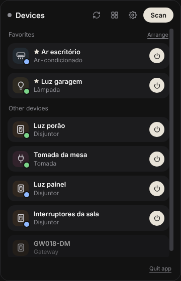
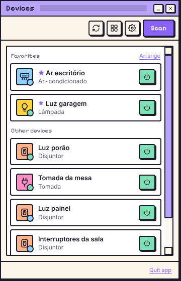
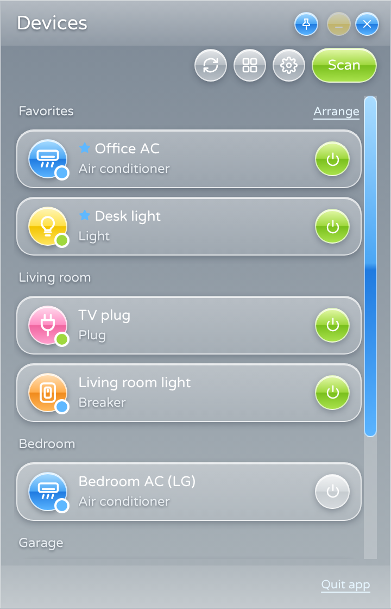
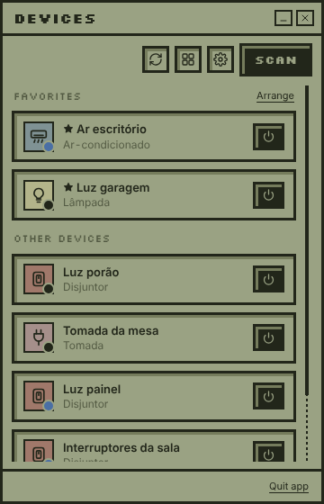
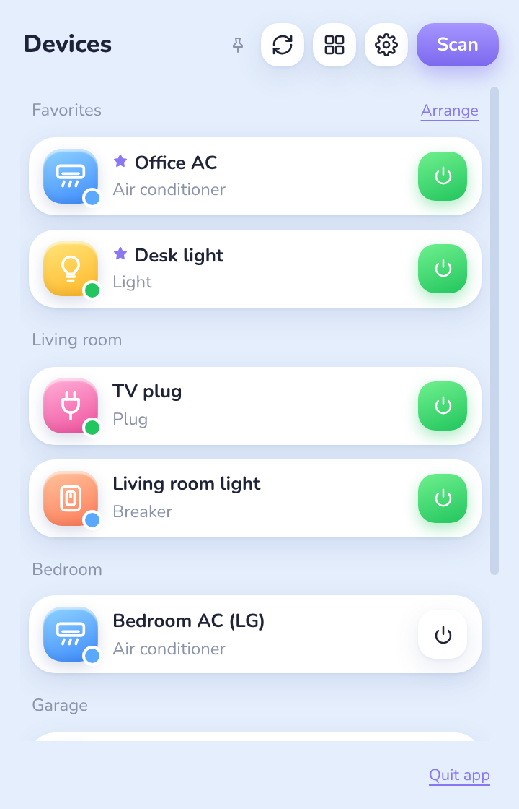
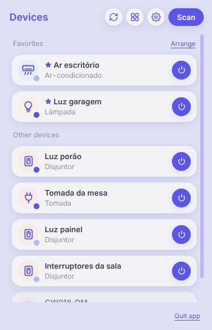
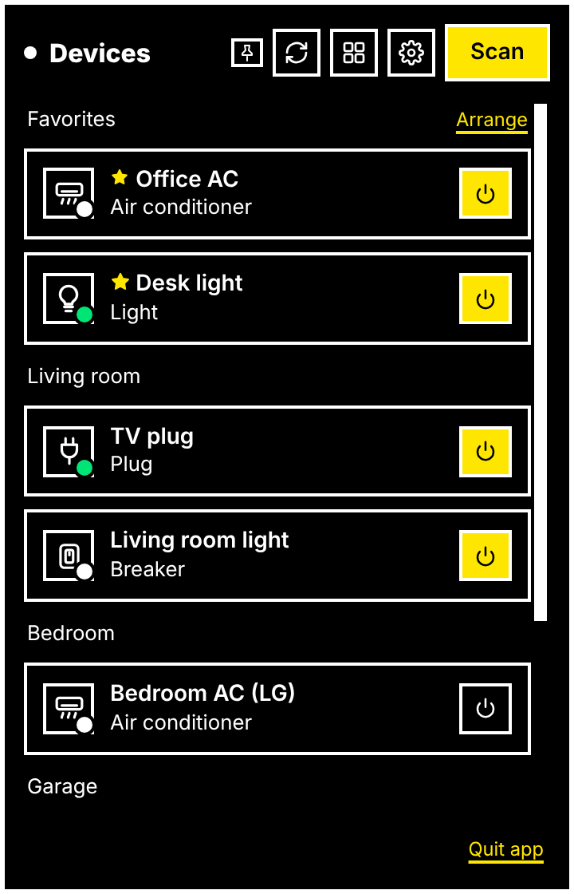
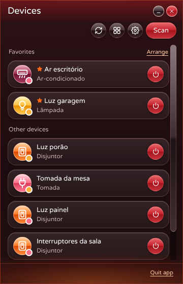
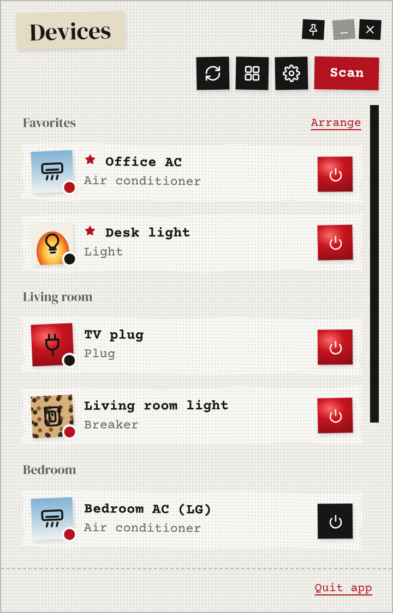

<div align="center">


# Lilac

**Control your Tuya / Smart Life gadgets from the menu bar — over your own network.**


**[⬇️ Download for Windows, macOS or Linux](https://github.com/tuliocll/lilac/releases)** · [how to install](#download)

<sub>Screenshots rendered with sample data. 🇧🇷 <a href="README.pt-BR.md">Leia em português</a></sub>

</div>

---

> [!WARNING]
> **This project is vibe-coded.** It was built in a long conversation between a human ([Tulio Calil](https://tuliocalil.com))
> and an AI (Claude, by Anthropic): the human set the direction, tested on real hardware and made the calls; the AI wrote most of
> the code, the tests and these docs. It has a real test suite (including interop tests against
> [tinytuya](https://github.com/jasonacox/tinytuya)), but it is **experimental** — expect rough edges and read the code before
> trusting it with anything important.

## Download

No programming needed: grab the file for your computer from the **[Releases page](https://github.com/tuliocll/lilac/releases)**
(the newest version is at the top; open **Assets** if the files are hidden).

| Your computer | File to download | How to start it |
|---|---|---|
| **Windows 10/11** | `Lilac-…-windows.zip` | Unzip it, open the folder and double-click **`lilac.exe`** |
| **macOS** | `Lilac-…-macos.dmg` | Open it and drag **Lilac** into Applications |
| **Linux** | `Lilac-…-linux-x86_64.tar.gz` | Extract it and run **`lilac`** |

**Windows: why are there two `.exe` files?** The folder has `lilac.exe` and `launcher.exe`, and that's expected.
`lilac.exe` is the app itself (everything is packed inside it, even the icon). `launcher.exe` is a small helper that tinyjs
uses to draw the window: it does nothing on its own, but `lilac.exe` needs it. So:

- always open **`lilac.exe`**;
- keep **both files in the same folder** (moving `lilac.exe` alone breaks it — move the whole folder instead);
- for a desktop shortcut, right-click `lilac.exe` → *Send to* → *Desktop*. Pinning the open window to the taskbar works too.

Linux works the same way: `lilac` is the app and `launcher` stays next to it.

**"Windows protected your PC" / "can't be opened"?** The builds aren't signed yet, so the system warns on the first run.
On Windows click **More info → Run anyway**. On macOS open **System Settings → Privacy & Security** and click
**Open Anyway** next to Lilac. You only need to do this once.

Once it's open, Lilac lives in the system tray (next to the clock) or the menu bar on macOS — click the lilac icon.

## What it does

- 🔎 **Finds Tuya devices on your LAN** by listening to their UDP broadcasts — no account needed for this part.
- 📱 **Logs into Smart Life with a QR code** (same flow as Home Assistant's official Tuya integration) to fetch device names,
  categories, data-point maps and the **local keys**.
- 🏠 **Controls devices locally** over TCP 6668 — once the keys are fetched, it works even with the internet down.
- ☁️ **Falls back to the cloud** for what can't be reached locally (Zigbee sub-devices behind a gateway, infrared remotes,
  unsupported protocol versions), clearly labelled “via cloud”.
- ❄️ **Infrared air conditioners** set up in Smart Life (any brand, any IR blaster): power, temperature, mode and fan.
  IR doesn't report state, so Lilac remembers the last command it sent — and says so.
- ⚡ **Shortcuts in the list**: up to 3 one-click buttons per device (toggle power, or pin a value like “Cool” or “22 °C”),
  chosen in the *Shortcuts in the list* section at the bottom of the device page.
- ⭐ **Favorites** at the top of the list, in your own order (Arrange ↑↓), and in the tray menu: toggle a light without even
  opening the panel. Optional global hotkey (<kbd>Ctrl</kbd>+<kbd>Alt</kbd>+<kbd>T</kbd>) and open-at-login.
- 📌 **Pin the panel**: the pin in the title bar keeps the panel above other windows instead of hiding when you click away.
  Drag it anywhere (any monitor) — it reopens in the same spot. Esc or ✕ still put it away while pinned.
- 🧩 **One page per gadget type**: an air conditioner gets a big temperature and mode/fan cards, a breaker gets a power
  button and energy readouts, a light gets brightness and white-tone sliders… Data points the profile doesn't know show up
  under “Advanced”, with a control inferred from their type. Only controls the device actually reports are shown.
- 🎨 **Nine themes**, picked in the welcome tour or in Settings — and community themes can be dropped into a folder.
- 🔑 **No account? Import keys** from tinytuya's `devices.json`.
- 🌍 **Languages**: Português (Brasil) and English, switchable in Settings.

## Themes

Every screen works in every theme — pick one in the welcome tour or in Settings → Appearance.

<table>
<tr><td align="center" valign="top"><br /><b>Moonlight</b><br /><sub>dark and quiet — the original</sub></td><td align="center" valign="top"><br /><b>Past Dream</b><br /><sub>a 1996 operating system that never was</sub></td><td align="center" valign="top"><br /><b>Frutiger Aero</b><br /><sub>glass, bubbles and gloss — the future of 2007</sub></td><td align="center" valign="top"><br /><b>CassiUI</b><br /><sub>an olive LCD screen with pixel type</sub></td></tr>
<tr><td align="center" valign="top"><br /><b>Cutelight</b><br /><sub>light and cute: baby blue, floating cards</sub></td><td align="center" valign="top"><br /><b>BoringLight</b><br /><sub>lavender, gray and indigo — no frills</sub></td><td align="center" valign="top"><br /><b>High Contrast</b><br /><sub>black, white and yellow — readable anywhere</sub></td><td align="center" valign="top"><br /><b>Frutiger Inferno</b><br /><sub>Aero's evil twin: red glass, embers and lava</sub></td></tr>
<tr><td align="center" valign="top"><br /><b>ConfusedPast</b><br /><sub>mixed-media collage: torn paper, tape and lipstick</sub></td></tr>
</table>

Make your own: a theme is one CSS file of design tokens (plus an optional font). Drop it in the themes folder
(Settings → *Themes folder*) — no rebuild — or send a PR. See [THEMING.md](apps/menubar/THEMING.md).

## What works (honest table)

| | Status |
|---|---|
| LAN discovery (protocols 3.1 → 3.5) | ✅ tested with real devices |
| Smart Life QR login + inventory | ✅ tested with a real account |
| Cloud control of Zigbee sub-devices (through a gateway) | ✅ tested with a real breaker |
| Infrared air conditioners through the cloud | ✅ power tested on a real AC · 🧪 temperature/mode/fan mapping still being confirmed |
| Local control, protocol **3.3** and **3.4** (session key + HMAC) | 🧪 passes against a simulator validated with tinytuya; real-device testing in progress |
| Other infrared remotes (TV, fan, humidifier, learned buttons) | ❌ not yet — see the roadmap |
| Local control, protocol 3.5 / 3.1 | ❌ not yet (goes through the cloud when logged in) |
| Zigbee/BLE sub-devices *locally* through a gateway | ❌ cloud only for now |
| Battery sensors | ⚠️ they sleep; values come from the cloud and may be stale |
| Colour lights (`colour_data_v2`, `colour_data`) | 🧪 hue + saturation picker |

**Device types with a dedicated page:** air conditioners/heaters/dehumidifiers (including infrared ones), switches and breakers,
plugs and power strips, lights, fans, covers/gates, sensors, gateways and IR blasters (info pages). Everything else gets the
generic page.

## Operating systems

| OS | Status |
|---|---|
| **Windows 10/11** | ✅ where it's being developed and tested (needs the WebView2 runtime, preinstalled on Windows 11) |
| **macOS 15+** | 🤞 tinyjs' primary platform, but untested here |
| **Linux** (glibc 2.35+, `libwebkit2gtk-4.1`) | 🤞 tinyjs beta, untested here |

There are no signed builds yet, so Windows SmartScreen and macOS Gatekeeper warn before the first run (see [Download](#download)).

## Why tinyjs?

Picking [tinyjs](https://tinyjs.app) was **an experiment**: a ~6 MB desktop runtime with a JavaScript backend
([txiki.js](https://github.com/saghul/txiki.js)) and the OS's own webview, no Electron, no Rust. We wanted to see how far it goes
for a real app — and it went pretty far: tray popover, OS keychain, UDP broadcast and TCP sockets all work from plain JS.

The bet is hedged, though. `packages/tuya-core` knows nothing about the runtime — networking comes in through a small
`Transport` interface (there are Node and txiki implementations). If tinyjs doesn't work out, only the shell changes.

Things we learned the hard way are documented in the code and in [THEMING.md](apps/menubar/THEMING.md).

## Getting started

Requires **Node 22+** (for development) and, for the tray app, **[tinyjs](https://tinyjs.app)**.

```bash
git clone https://github.com/tuliocll/lilac
cd lilac
npm install
npm test

# CLI — handy for debugging
npm run discover                          # who's announcing on the LAN
npm run login                             # QR login in the terminal
npm run devices -- --dps                  # account × network, with each device's data points
npm run control -- "Garage light" switch_1=true
npm run control -- "Office AC" --inspect  # raw cloud answers, for devices that don't behave

# Tray app
irm https://tinyjs.app/install.ps1 | iex     # Windows (PowerShell)
curl -fsSL https://tinyjs.app/install | sh   # macOS / Linux
cd apps/menubar && tinyjs dev
```

Your Smart Life **user code** is in the app under **Me → ⚙ Settings → Account and Security → User Code**.
No device around? `npm run fake-device` announces three fake ones.

## Project layout

```
packages/
  tuya-core/        protocol in plain TypeScript: discovery, frames, crypto, local TCP (3.3/3.4),
                    Smart Life cloud (login, inventory, commands) and the infrared AC translation
  gadgets/          one folder per gadget type: gadget.json + icon.svg  →  page layout and controls
  transport-node/   Transport for Node (CLI, tests)
  transport-txiki/  Transport for txiki.js (tinyjs backend)
apps/
  cli/              discover / login / devices / control / fake-device
  menubar/
    assets/               app and tray icons
    src/main.ts           API the page calls + tinyjs events (thin)
    src/backend/          account · network · control (local/cloud routes) · view · tray · favorites
                          · quick-actions · remembered (state of IR devices) · user-themes
    src/frontend/ui/      one small module per screen: devices, device-page, controls, settings, onboarding…
    src/frontend/themes/  the nine themes + tokens.json, the theme contract
docs/
  ROADMAP.md        what's next, what was done and what was dropped
```

The code is plain functions and closures — no class hierarchies. `tuya-core` has no runtime dependency, the backend modules
own their state with small explicit APIs, and every UI module hangs off a single `window.Lilac` namespace in dependency order.

## Contributing

- **A device doesn't work?** Open an issue with the output of `npm run control -- "<name>" --inspect` (keys are hidden).
  That's how infrared air conditioners got supported.
- **New gadget type** (icon, name, colours, controls): add a folder to `packages/gadgets/gadgets/` — see
  [its README](packages/gadgets/gadgets/README.md). No code needed.
- **New theme**: see [THEMING.md](apps/menubar/THEMING.md). Every UI change must work in every theme and language;
  the contract tests enforce it.
- **New language**: copy the `en` block in `apps/menubar/src/frontend/ui/i18n.js`.
- Run `npm run assets`, `npm test` and `npm run typecheck` before opening a PR. Touched networking? Also run
  `npm run test:txiki` (needs [txiki.js](https://github.com/saghul/txiki.js)'s `tjs` in your PATH, or `TJS=/path/to/tjs`).

## Privacy & security

- Local keys and the session token live in the **OS credential store** (Keychain / Credential Manager / Secret Service), never in
  plain JSON. The CLI keeps a **development** copy in `~/.lilac/` (readable only by you on macOS/Linux; on Windows it's a
  plain file in your user folder).
- The cloud is used to fetch keys and names, and to reach what isn't on your network; day-to-day control of local devices goes
  straight to them.
- ⚠️ **About the QR login `clientId`:** the Smart Life QR flow requires a partner app ID registered with Tuya. For now Lilac uses
  Home Assistant's (the only public one) — fine for testing with your own account, **not fine for a public release**. Getting our
  own credentials from Tuya is on the roadmap; it lives in one file (`packages/tuya-core/src/cloud/app-credentials.ts`).

## Roadmap

The living backlog is in [docs/ROADMAP.md](docs/ROADMAP.md). Highlights: real-device validation of local control,
more infrared remotes, protocol 3.5, live cloud updates, scenes and automations tied to your computer
(lock the screen → desk light off).

## Credits

[tinyjs](https://tinyjs.app) · [txiki.js](https://github.com/saghul/txiki.js) ·
[tuya-device-sharing-sdk](https://github.com/tuya/tuya-device-sharing-sdk) (QR login reference) ·
[tinytuya](https://github.com/jasonacox/tinytuya) (local protocol reference) ·
[@noble/ciphers & hashes](https://paulmillr.com/noble/) · [qrcode-generator](https://github.com/kazuhikoarase/qrcode-generator) ·
fonts [Pixelify Sans](https://github.com/eifetx/Pixelify-Sans), [Varela Round](https://github.com/alefalefalef/Varela-Round-Hebrew),
[Silkscreen](https://github.com/googlefonts/silkscreen), [Nunito](https://github.com/googlefonts/nunito),
[Courier Prime](https://github.com/quoteunquoteapps/CourierPrime) and [DM Serif Display](https://github.com/googlefonts/dm-fonts) (all OFL).

MIT © Tulio Calil · [github.com/tuliocll/lilac](https://github.com/tuliocll/lilac).
Independent project, **not affiliated with Tuya**. Tuya and Smart Life are trademarks of their owners.
