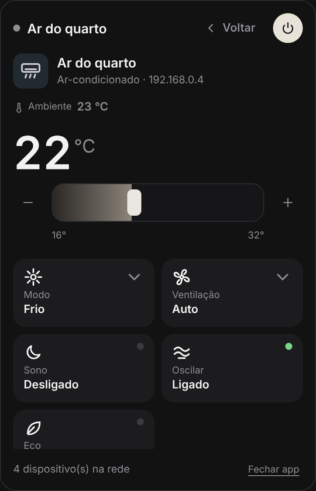
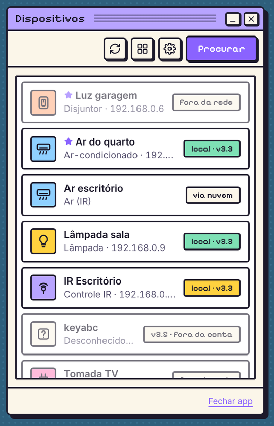
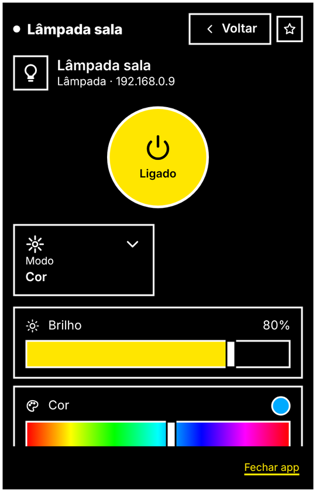

<div align="center">

# TuyaBar

**Control your Tuya / Smart Life gadgets from the menu bar — over your own network.**





<sub>Screenshots rendered with sample data. 🇧🇷 <a href="README.pt-BR.md">Leia em português</a></sub>

</div>

---

> [!WARNING]
> **This project is vibe-coded.** It was built in a long conversation between a human ([Tulio Calil](https://tuliocalil.com))
> and an AI (Claude, by Anthropic): the human set the direction, tested on real hardware and made the calls; the AI wrote most of
> the code, the tests and this README. It has a real test suite (including interop tests against
> [tinytuya](https://github.com/jasonacox/tinytuya)), but it is **experimental** — expect rough edges and read the code before
> trusting it with anything important.

## What it does

- 🔎 **Finds Tuya devices on your LAN** by listening to their UDP broadcasts — no account needed for this part.
- 📱 **Logs into Smart Life with a QR code** (same flow as Home Assistant's official Tuya integration) to fetch device names,
  categories, data-point maps and the **local keys**.
- 🏠 **Controls devices locally** over TCP 6668 — once the keys are fetched, it works even with the internet down.
- ☁️ **Falls back to the cloud** for what can't be reached locally (Zigbee sub-devices behind a gateway, IR air conditioners,
  unsupported protocol versions), clearly labelled “via cloud”.
- ⭐ **Favorites in the tray menu**: toggle a light without even opening the panel. Optional global hotkey
  (<kbd>Ctrl</kbd>+<kbd>Alt</kbd>+<kbd>T</kbd>) and open-at-login.
- 🧩 **One page per gadget type**: an air conditioner gets a big temperature and mode/fan chips, a breaker gets a power
  button and energy readouts, a light gets brightness and white-tone sliders… Data points the profile doesn't know show up
  under “Advanced”, with a control inferred from their type.
- 🎨 **Themes**: *Moonlight* (dark, quiet), *Past Dream* (a 1996 operating system that never was) and *High Contrast*.
  Community themes can be dropped into a folder — no rebuild.
- 🔑 **No account? Import keys** from tinytuya's `devices.json`.
- 🌍 **Languages**: Português (Brasil) and English, switchable in Settings.

## What works (honest table)

| | Status |
|---|---|
| LAN discovery (protocols 3.1 → 3.5) | ✅ tested with real devices |
| Smart Life QR login + inventory | ✅ tested with a real account |
| Local control, protocol **3.3** and **3.4** (session key + HMAC) | 🧪 tested against a simulator that passes tinytuya interop; real-device testing in progress |
| Cloud control (sub-devices, IR air conditioners, protocol 3.5) | 🧪 same API as Home Assistant's Tuya integration; untested with real devices. IR AC codes vary — unknown ones show up under “Advanced” |
| Local control, protocol 3.5 / 3.1 | ❌ not yet (goes through the cloud when logged in) |
| Zigbee/BLE sub-devices *locally* through a gateway | ❌ cloud only for now |
| Battery sensors | ⚠️ they sleep; values come from the cloud and may be stale |
| Colour lights (`colour_data_v2`, `colour_data`) | 🧪 hue + saturation picker |

**Device types with a dedicated page:** air conditioners/heaters/dehumidifiers, switches and breakers, plugs and power strips,
lights, fans, covers/gates, sensors, gateways and IR blasters (info pages). Everything else gets the generic page.

## Operating systems

| OS | Status |
|---|---|
| **Windows 10/11** | ✅ where it's being developed and tested (needs the WebView2 runtime, preinstalled on Windows 11) |
| **macOS 15+** | 🤞 tinyjs' primary platform, but untested here |
| **Linux** (glibc 2.35+, `libwebkit2gtk-4.1`) | 🤞 tinyjs beta, untested here |

## Why tinyjs?

Picking [tinyjs](https://tinyjs.app) was **an experiment**: a ~6 MB desktop runtime with a JavaScript backend
([txiki.js](https://github.com/saghul/txiki.js)) and the OS's own webview, no Electron, no Rust. We wanted to see how far it goes
for a real app — and it went pretty far: tray popover, OS keychain, UDP broadcast and TCP sockets all work from plain JS.

The bet is hedged, though. `packages/tuya-core` knows nothing about the runtime — networking comes in through a small
`Transport` interface (there are Node and txiki implementations). If tinyjs doesn't work out, only the shell changes.

Things we learned the hard way are documented in the code, e.g. `file://` + WebView2 blocks CSS masks and web fonts under CORS,
so icons and fonts are embedded as `data:` URIs by `npm run assets`.

## Getting started

Requires **Node 22+** (for development) and, for the tray app, **[tinyjs](https://tinyjs.app)**.

```bash
npm install
npm test

# CLI — handy for debugging
npm run discover                 # who's announcing on the LAN
npm run login                    # QR login in the terminal
npm run devices -- --dps         # account × network, with each device's data points
npm run control -- "Garage light" switch_1=true

# Tray app
irm https://tinyjs.app/install.ps1 | iex     # Windows (PowerShell)
curl -fsSL https://tinyjs.app/install | sh   # macOS / Linux
cd apps/menubar && tinyjs dev
```

Your Smart Life **user code** is in the app under **Me → ⚙ Settings → Account and Security → User Code**.
No device around? `npm run fake-device` announces three fake ones.

## Project layout

```
packages/
  tuya-core/        protocol in plain TypeScript: discovery, frames, crypto, local TCP (3.3/3.4), Smart Life cloud
  gadgets/          one folder per gadget type: gadget.json + icon.svg  →  page layout and controls
  transport-node/   Transport for Node (CLI, tests)
  transport-txiki/  Transport for txiki.js (tinyjs backend)
apps/
  cli/              discover / login / devices / control / fake-device
  menubar/
    src/main.ts           API the page calls + tinyjs events (thin)
    src/backend/          account · network · control (local/cloud routes) · view · tray · favorites · user-themes
    src/frontend/ui/      one small module per screen: devices, device-page, controls, settings, login…
    src/frontend/themes/  Moonlight · Past Dream · High Contrast (+ tokens.json, the theme contract)
```

The code is plain functions and closures — no class hierarchies. `tuya-core` has no runtime dependency, the backend modules
own their state with small explicit APIs, and every UI module hangs off a single `window.TuyaBar` namespace in dependency order.

## Contributing

- **New gadget type** (icon, name, colours, controls): add a folder to `packages/gadgets/gadgets/` — see
  [its README](packages/gadgets/gadgets/README.md). No code needed.
- **New theme**: see [THEMING.md](apps/menubar/THEMING.md). Every UI change must work in every theme and language;
  the contract tests enforce it.
- **New language**: copy the `en` block in `apps/menubar/src/frontend/ui/i18n.js`.
- Run `npm run assets`, `npm test` and `npm run typecheck` before opening a PR.

## Privacy & security

- Local keys and the session token live in the **OS credential store** (Keychain / Credential Manager / Secret Service), never in
  plain JSON. The CLI keeps a dev copy in `~/.tuyabar/`.
- The cloud is used to fetch keys and names; day-to-day control goes straight to your devices.
- ⚠️ **About the QR login `clientId`:** the Smart Life QR flow requires a partner app ID registered with Tuya. For now TuyaBar uses
  Home Assistant's (the only public one) — fine for testing with your own account, **not fine for a public release**. Getting our
  own credentials from Tuya is on the roadmap; it lives in one file (`packages/tuya-core/src/cloud/app-credentials.ts`).

## Roadmap

- [ ] Real-device validation of local control (3.3/3.4) and cloud control · local protocol 3.5
- [ ] Sub-devices locally through gateways (`cid`) · raw IR learning/sending
- [ ] Scenes · live state in the device list
- [ ] Own Tuya partner credentials
- [ ] Signed builds (the release workflow in `.github/workflows/release.yml` builds unsigned ones — untested until the first tag)

## Credits

[tinyjs](https://tinyjs.app) · [txiki.js](https://github.com/saghul/txiki.js) ·
[tuya-device-sharing-sdk](https://github.com/tuya/tuya-device-sharing-sdk) (QR login reference) ·
[tinytuya](https://github.com/jasonacox/tinytuya) (local protocol reference) ·
[@noble/ciphers & hashes](https://paulmillr.com/noble/) · [qrcode-generator](https://github.com/kazuhikoarase/qrcode-generator) ·
[Pixelify Sans](https://github.com/eifetx/Pixelify-Sans) (OFL).

MIT © Tulio Calil. Independent project, **not affiliated with Tuya**. Tuya and Smart Life are trademarks of their owners.
