<div align="center">

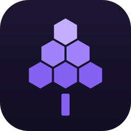

# Lilac

**Controle seus gadgets Tuya / Smart Life pela barra de tarefas — pela sua própria rede.**

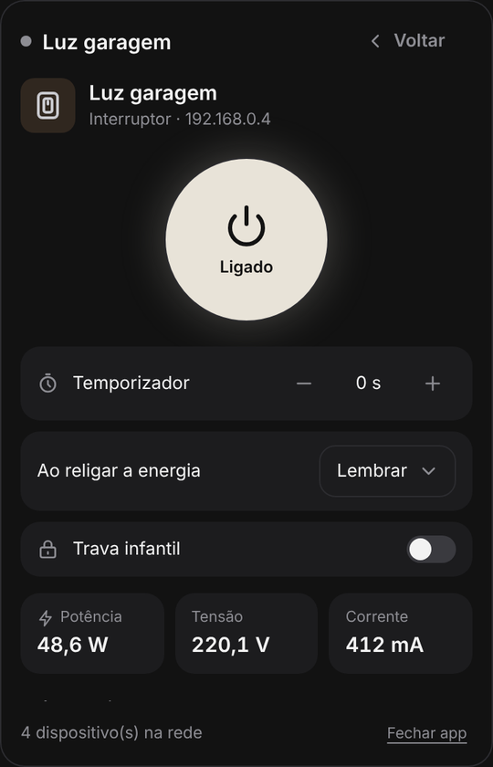
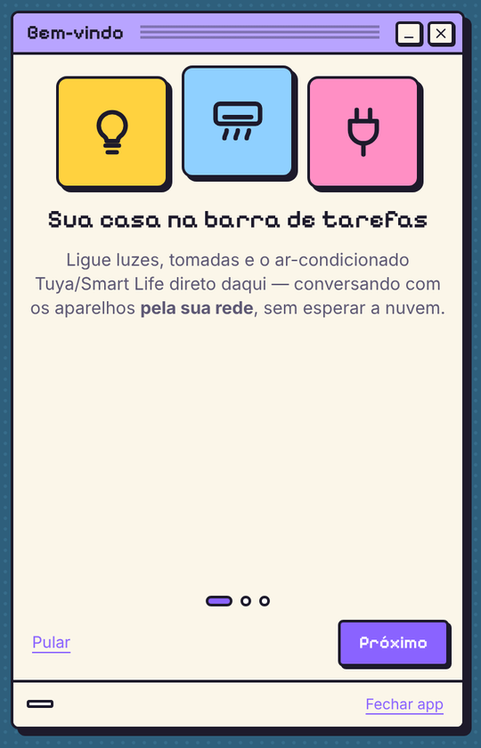
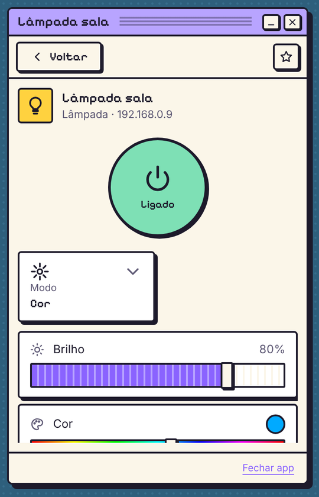

**[⬇️ Baixar para Windows, macOS ou Linux](https://github.com/tuliocll/lilac/releases)** · [como instalar](#baixar)

<sub>Telas renderizadas com dados de exemplo. 🇺🇸 <a href="README.md">Read in English</a></sub>

</div>

---

> [!WARNING]
> **Este projeto foi vibecodado.** Ele nasceu de uma conversa longa entre um humano ([Tulio Calil](https://tuliocalil.com)) e uma
> IA (o Claude, da Anthropic): o humano deu a direção, testou no hardware de verdade e tomou as decisões; a IA escreveu a maior
> parte do código, dos testes e destes documentos. Tem uma suíte de testes de verdade (inclusive interoperabilidade com o
> [tinytuya](https://github.com/jasonacox/tinytuya)), mas é **experimental** — espere arestas e leia o código antes de confiar
> nele para algo importante.

## Baixar

Não precisa saber programar: baixe o arquivo do seu computador na **[página de Releases](https://github.com/tuliocll/lilac/releases)**
(a versão mais nova fica no topo; clique em **Assets** se os arquivos estiverem escondidos).

| Seu computador | Arquivo para baixar | Como abrir |
|---|---|---|
| **Windows 10/11** | `Lilac-…-windows.zip` | Descompacte, abra a pasta e dê dois cliques no **`lilac.exe`** |
| **macOS** | `Lilac-…-macos.dmg` | Abra e arraste o **Lilac** para Aplicativos |
| **Linux** | `Lilac-…-linux-x86_64.tar.gz` | Extraia e rode o **`lilac`** |

**Windows: por que tem dois `.exe`?** A pasta tem o `lilac.exe` e o `launcher.exe`, e é assim mesmo.
O `lilac.exe` é o app de verdade (tudo vai dentro dele, até o ícone). O `launcher.exe` é um ajudante que o tinyjs usa
para desenhar a janela: sozinho ele não faz nada, mas o `lilac.exe` precisa dele. Então:

- abra sempre o **`lilac.exe`**;
- deixe **os dois arquivos na mesma pasta** (mover só o `lilac.exe` faz ele parar de funcionar; mova a pasta inteira);
- para criar um atalho, clique com o botão direito no `lilac.exe` → *Enviar para* → *Área de trabalho*. Fixar a janela
  aberta na barra de tarefas também funciona.

No Linux é igual: o `lilac` é o app e o `launcher` fica do lado.

**"O Windows protegeu o computador" / "não pode ser aberto"?** As versões ainda não são assinadas, então o sistema avisa
na primeira vez. No Windows clique em **Mais informações → Executar assim mesmo**. No macOS abra **Ajustes do Sistema →
Privacidade e Segurança** e clique em **Abrir Mesmo Assim** ao lado do Lilac. Só precisa fazer isso uma vez.

Depois de aberto, o Lilac fica na bandeja do sistema (perto do relógio) ou na barra de menus no macOS: é só clicar no
ícone lilás.

## O que ele faz

- 🔎 **Acha os aparelhos Tuya da sua rede** escutando os anúncios UDP — sem conta nenhuma.
- 📱 **Login no Smart Life por QR code** (o mesmo fluxo da integração oficial do Home Assistant) para buscar nomes, categorias,
  mapas de DPs e as **local keys**.
- 🏠 **Controla os aparelhos localmente** (TCP 6668) — depois de buscar as chaves, funciona até sem internet.
- ☁️ **Usa a nuvem quando a rede local não alcança** (sub-dispositivos de gateway, controles infravermelhos, protocolos ainda não
  suportados), sempre marcado como “via nuvem”.
- ❄️ **Ares-condicionados por infravermelho** cadastrados no Smart Life (qualquer marca, qualquer emissor): liga/desliga,
  temperatura, modo e ventilação. O infravermelho não informa o estado, então o Lilac lembra o último comando enviado — e avisa.
- 🇱🇬 **Ares-condicionados LG (LG ThinQ)**: os modelos Wi-Fi da LG do app ThinQ, pela API oficial da LG (ThinQ Connect) —
  liga/desliga, temperatura (de 0,5 em 0,5 °C), modo, ventilação, aleta e economia de energia, na mesma página dos outros ares.
  Conecte nas boas-vindas ou em *Configurações → LG ThinQ* com um token pessoal gerado em [connect-pat.lgthinq.com](https://connect-pat.lgthinq.com).
- ⚡ **Atalhos na lista**: até 3 botões de um clique por aparelho (liga/desliga, ou um valor fixado como “Frio” ou “22 °C”),
  escolhidos na seção *Atalhos na lista*, no fim da página do aparelho.
- ⭐ **Favoritos** no topo da lista, na ordem que você escolher (Organizar ↑↓), e no menu da bandeja: liga a luz sem nem abrir o
  painel. Atalho global opcional (<kbd>Ctrl</kbd>+<kbd>Alt</kbd>+<kbd>T</kbd>) e abrir com o sistema.
- 📌 **Fixar o painel**: o alfinete na barra de título deixa o painel por cima das outras janelas, sem sumir ao clicar fora.
  Arraste-o para onde quiser (vale qualquer monitor) — ele reabre no mesmo lugar. Esc ou ✕ guardam o painel mesmo fixado.
- 🧩 **Uma página por tipo de gadget**: o ar ganha temperatura grande e cartões de modo/ventilação, o disjuntor ganha botão de
  energia e leituras de consumo, a lâmpada ganha brilho e tom de branco… DPs que o perfil não conhece aparecem em “Avançado”,
  com o controle inferido pelo tipo. Só aparecem os controles que o aparelho realmente informa.
- 🎨 **Nove temas**, escolhidos nas boas-vindas ou nas configurações — e temas da comunidade entram por uma pasta.
- 🔑 **Sem conta? Importe as chaves** do `devices.json` do tinytuya.
- 🌍 **Idiomas**: português e inglês, trocáveis nas configurações.

## Temas

Toda tela funciona em todos os temas — escolha um nas boas-vindas ou em Configurações → Aparência.

<table>
<tr><td align="center" valign="top">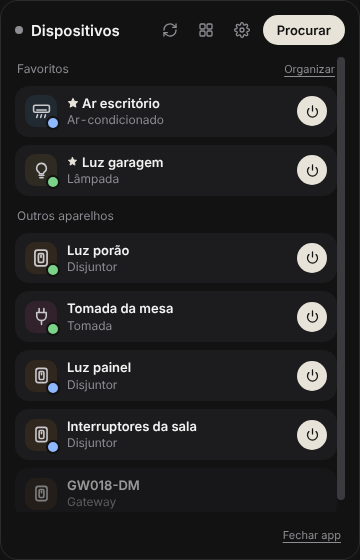<br /><b>Moonlight</b><br /><sub>escuro e discreto — o original</sub></td><td align="center" valign="top">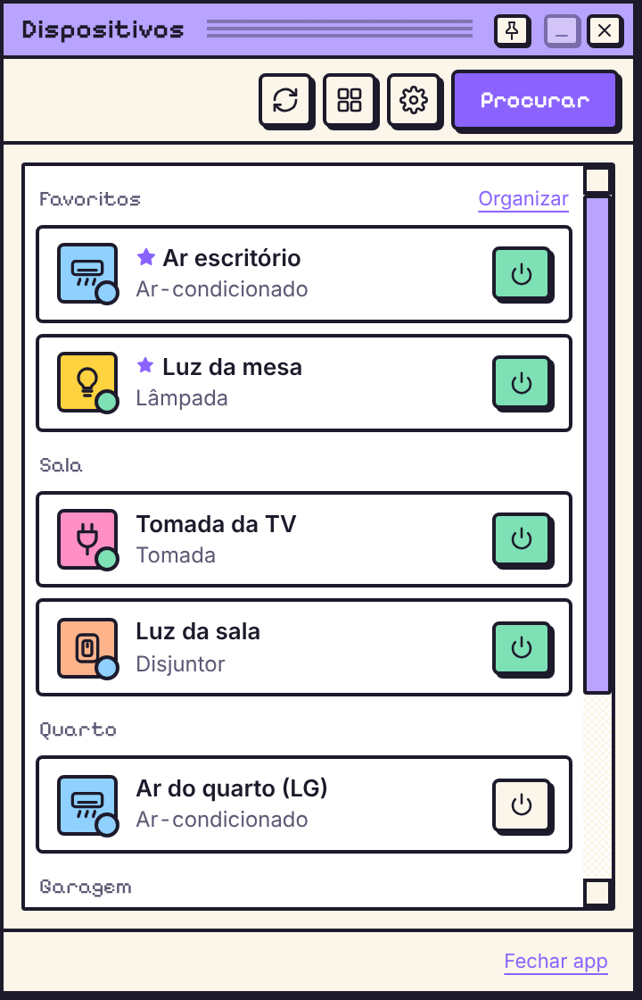<br /><b>Past Dream</b><br /><sub>um sistema de 1996 que nunca existiu</sub></td><td align="center" valign="top">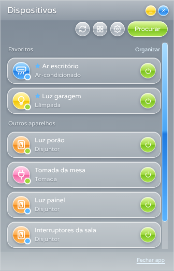<br /><b>Frutiger Aero</b><br /><sub>vidro, bolhas e brilho — o futuro de 2007</sub></td><td align="center" valign="top">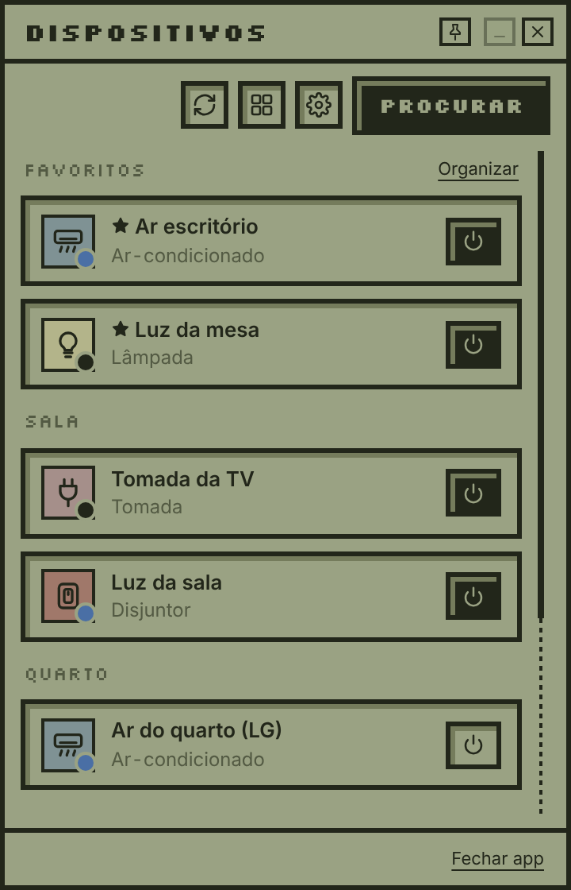<br /><b>CassiUI</b><br /><sub>uma tela de LCD oliva, letra pixelada</sub></td></tr>
<tr><td align="center" valign="top">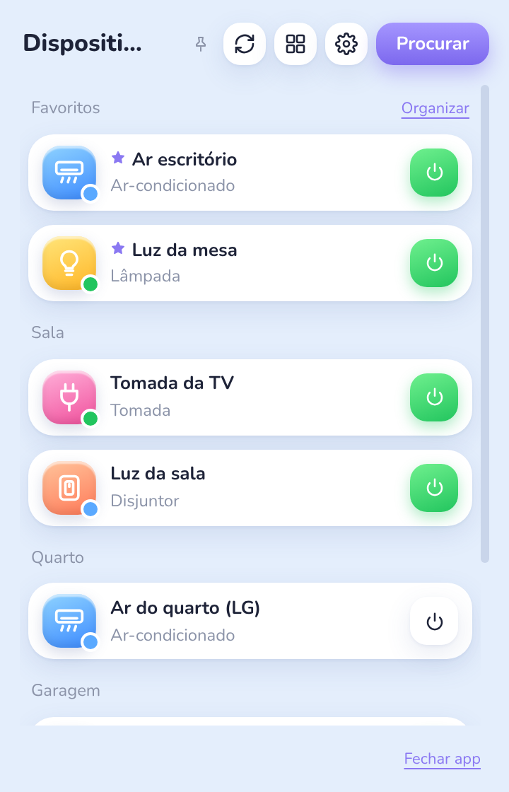<br /><b>Cutelight</b><br /><sub>claro e fofo: azul-bebê, cartões flutuando</sub></td><td align="center" valign="top">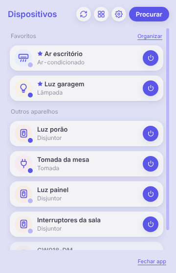<br /><b>BoringLight</b><br /><sub>lavanda, cinza e índigo — sem firula</sub></td><td align="center" valign="top">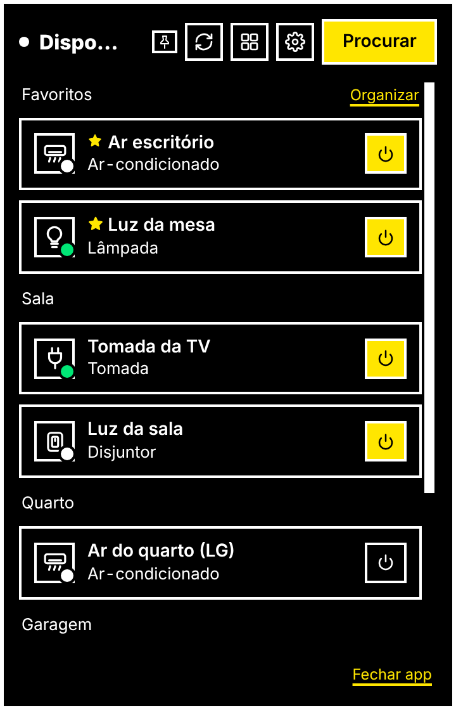<br /><b>Alto Contraste</b><br /><sub>preto, branco e amarelo — legível em qualquer luz</sub></td><td align="center" valign="top">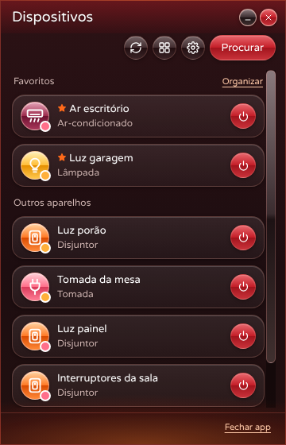<br /><b>Frutiger Inferno</b><br /><sub>o irmão do mal do Aero: vidro vermelho, brasa e lava</sub></td></tr>
<tr><td align="center" valign="top">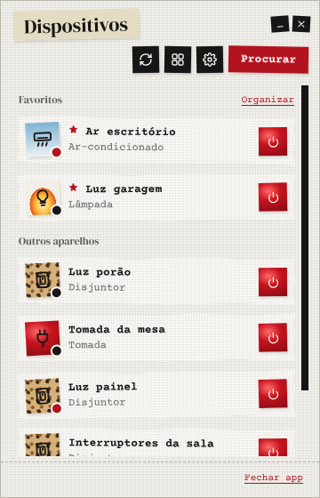<br /><b>ConfusedPast</b><br /><sub>colagem mixed media: papel rasgado, fita crepe e batom</sub></td></tr>
</table>

Crie o seu: um tema é um arquivo CSS de tokens de design (e, se quiser, uma fonte). Coloque na pasta de temas
(Configurações → *Pasta de temas*) — sem recompilar — ou mande um PR. Veja o [THEMING.pt-BR.md](apps/menubar/THEMING.pt-BR.md).

## O que funciona (tabela honesta)

| | Situação |
|---|---|
| Descoberta na rede (protocolos 3.1 → 3.5) | ✅ testado com aparelhos reais |
| Login por QR + inventário | ✅ testado com conta real |
| Controle pela nuvem de sub-dispositivos Zigbee (via gateway) | ✅ testado com um disjuntor real |
| Ares-condicionados por infravermelho pela nuvem | ✅ liga/desliga testado num ar real · 🧪 temperatura/modo/ventilação em confirmação |
| Ares-condicionados LG (ThinQ Connect) | ✅ lista, perfis e estado lidos de aparelhos reais (dois modelos) · 🧪 controle em confirmação |
| Controle local, protocolos **3.3** e **3.4** (chave de sessão + HMAC) | 🧪 passa contra um simulador validado com o tinytuya; teste em aparelho real em andamento |
| Outros controles infravermelhos (TV, ventilador, umidificador, botões aprendidos) | ❌ ainda não — veja o roadmap |
| Controle local 3.5 / 3.1 | ❌ ainda não (vai pela nuvem quando há conta) |
| Sub-dispositivos Zigbee/BLE *localmente* via gateway | ❌ só pela nuvem por enquanto |
| Sensores a bateria | ⚠️ dormem; valores vêm da nuvem e podem estar velhos |
| Lâmpadas coloridas (`colour_data_v2`, `colour_data`) | 🧪 seletor de matiz + saturação |

**Tipos com página própria:** ares-condicionados/aquecedores/desumidificadores (inclusive por infravermelho), interruptores e
disjuntores, tomadas e réguas, lâmpadas, ventiladores, cortinas/portões, sensores, gateways e emissores IR (páginas informativas).
O resto ganha a página genérica.

## Sistemas operacionais

| SO | Situação |
|---|---|
| **Windows 10/11** | ✅ onde está sendo desenvolvido e testado (precisa do WebView2, que já vem no Windows 11) |
| **macOS 15+** | 🤞 plataforma principal do tinyjs, mas não testado aqui |
| **Linux** (glibc 2.35+, `libwebkit2gtk-4.1`) | 🤞 beta no tinyjs, não testado aqui |

Ainda não há versões assinadas, então o SmartScreen do Windows e o Gatekeeper do macOS avisam antes da primeira execução (veja [Baixar](#baixar)).

## Por que tinyjs?

Usar o [tinyjs](https://tinyjs.app) foi **um teste**: um runtime desktop de ~6 MB, com backend em JavaScript
([txiki.js](https://github.com/saghul/txiki.js)) e o webview do próprio sistema — sem Electron, sem Rust. Queríamos ver até onde
ele vai num app de verdade, e foi longe: popover na bandeja, cofre de senhas do SO, UDP broadcast e TCP, tudo em JS.

A aposta tem rede de proteção: o `packages/tuya-core` não sabe em que runtime está — a rede entra por uma interface `Transport`
(há implementações para Node e txiki). Se o tinyjs não vingar, só a casca muda.

O que aprendemos apanhando está documentado no código e no [THEMING.pt-BR.md](apps/menubar/THEMING.pt-BR.md).

## Começando

Precisa de **Node 22+** (desenvolvimento) e, para o app de bandeja, do **[tinyjs](https://tinyjs.app)**.

```bash
git clone https://github.com/tuliocll/lilac
cd lilac
npm install
npm test

# CLI — útil para depurar
npm run discover                              # quem está anunciando na rede
npm run login                                 # login por QR no terminal
npm run devices -- --dps                      # conta × rede, com os DPs de cada aparelho
npm run control -- "Luz garagem" switch_1=true
npm run control -- "Ar escritório" --inspect  # respostas cruas da nuvem, para aparelhos que não se comportam
npm run lg -- --inspect                       # LG ThinQ: aparelhos + perfil/estado crus (pede o token uma vez)

# App de bandeja
irm https://tinyjs.app/install.ps1 | iex     # Windows (PowerShell)
curl -fsSL https://tinyjs.app/install | sh   # macOS / Linux
cd apps/menubar && tinyjs dev
```

O **código de usuário** fica no Smart Life em **Eu → ⚙ Configurações → Conta e segurança → Código de usuário**.
Sem aparelho por perto? `npm run fake-device` anuncia três de mentira.

## Organização do projeto

```
packages/
  tuya-core/        o protocolo em TypeScript puro: descoberta, frames, criptografia, TCP local (3.3/3.4),
                    nuvem Smart Life (login, inventário, comandos) e a tradução dos ares por infravermelho
  gadgets/          uma pasta por tipo de gadget: gadget.json + icon.svg  →  layout e controles da página
  transport-node/   Transport para Node (CLI, testes)
  transport-txiki/  Transport para txiki.js (backend do tinyjs)
  thinq/            cliente da LG ThinQ Connect e a tradução dos ares-condicionados LG
apps/
  cli/              discover / login / devices / control / fake-device / lg
  menubar/
    assets/               ícones do app e da bandeja
    src/main.ts           API que a página chama + eventos do tinyjs (fino)
    src/backend/          account · thinq (LG) · network · control (rotas local/nuvem) · view · tray · favorites
                          · quick-actions · remembered (estado dos aparelhos IR) · user-themes
    src/frontend/ui/      um módulo pequeno por tela: devices, device-page, controls, settings, onboarding…
    src/frontend/themes/  os nove temas + tokens.json, o contrato de temas
docs/
  ROADMAP.md        o que vem, o que foi feito e o que foi descartado
```

O código é feito de funções e closures — sem hierarquias de classe. O `tuya-core` não depende de runtime, os módulos do backend
são donos do próprio estado com APIs pequenas e explícitas, e cada módulo da interface fica pendurado num único `window.Lilac`,
na ordem de dependência.

## Contribuindo

- **Aparelho não funciona?** Abra uma issue com a saída de `npm run control -- "<nome>" --inspect` (as chaves saem escondidas).
  Foi assim que os ares por infravermelho passaram a funcionar.
- **Novo tipo de gadget** (ícone, nome, cores, controles): uma pasta em `packages/gadgets/gadgets/` —
  veja [o README de lá](packages/gadgets/gadgets/README.pt-BR.md). Sem código.
- **Novo tema**: [THEMING.pt-BR.md](apps/menubar/THEMING.pt-BR.md). Toda mudança de interface precisa funcionar em todos os
  temas e idiomas — os testes de contrato garantem.
- **Novo idioma**: copie o bloco `en` em `apps/menubar/src/frontend/ui/i18n.js`.
- Rode `npm run assets`, `npm test` e `npm run typecheck` antes de abrir um PR. Mexeu na rede? Rode também
  `npm run test:txiki` (precisa do `tjs` do [txiki.js](https://github.com/saghul/txiki.js) no PATH, ou `TJS=/caminho/do/tjs`).

## Privacidade e segurança

- Local keys e o token da sessão ficam no **cofre de credenciais do sistema** (Keychain / Gerenciador de Credenciais / Secret
  Service), nunca em JSON. A CLI guarda uma cópia **de desenvolvimento** em `~/.lilac/` (só você lê, no macOS/Linux; no Windows
  é um arquivo comum na sua pasta de usuário).
- A nuvem serve para buscar chaves e nomes e para alcançar o que não está na sua rede; no dia a dia, os aparelhos locais são
  controlados direto.
- ⚠️ **Sobre o `clientId` do login por QR:** o fluxo exige um ID de app parceiro registrado na Tuya. Por enquanto o Lilac usa o do
  Home Assistant (o único público) — ok para testar com a sua conta, **não ok para um lançamento público**. Obter credenciais
  próprias está no roadmap; fica num arquivo só (`packages/tuya-core/src/cloud/app-credentials.ts`).

## Roadmap

O backlog vivo fica em [docs/ROADMAP.md](docs/ROADMAP.md) (em inglês). Destaques: validar o controle local com aparelhos reais,
mais controles infravermelhos, protocolo 3.5, atualizações da nuvem em tempo real, cenas e automações ligadas ao computador
(bloqueou a tela → apaga a luz da mesa).

## Créditos

[tinyjs](https://tinyjs.app) · [txiki.js](https://github.com/saghul/txiki.js) ·
[tuya-device-sharing-sdk](https://github.com/tuya/tuya-device-sharing-sdk) (referência do login por QR) ·
[tinytuya](https://github.com/jasonacox/tinytuya) (referência do protocolo local) ·
[@noble/ciphers & hashes](https://paulmillr.com/noble/) · [qrcode-generator](https://github.com/kazuhikoarase/qrcode-generator) ·
fontes [Pixelify Sans](https://github.com/eifetx/Pixelify-Sans), [Varela Round](https://github.com/alefalefalef/Varela-Round-Hebrew),
[Silkscreen](https://github.com/googlefonts/silkscreen), [Nunito](https://github.com/googlefonts/nunito),
[Courier Prime](https://github.com/quoteunquoteapps/CourierPrime) e [DM Serif Display](https://github.com/googlefonts/dm-fonts) (todas OFL).

MIT © Tulio Calil · [github.com/tuliocll/lilac](https://github.com/tuliocll/lilac).
Projeto independente, **sem vínculo com a Tuya**. Tuya e Smart Life são marcas de seus donos.
