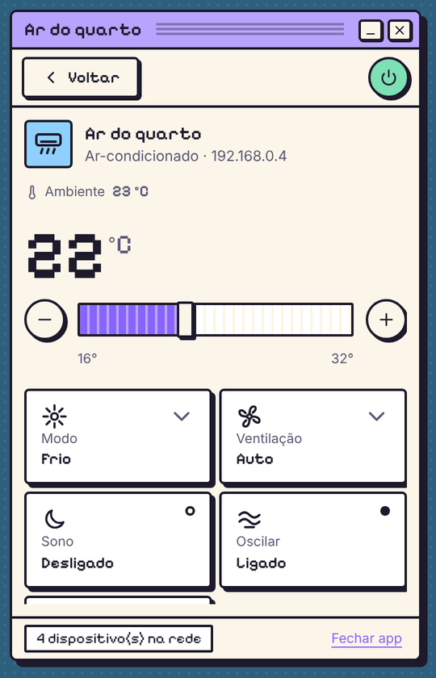

<div align="center">

# TuyaBar

**Controle seus gadgets Tuya / Smart Life pela barra de tarefas — pela sua própria rede.**




<sub>Telas renderizadas com dados de exemplo. 🇺🇸 <a href="README.md">Read in English</a></sub>

</div>

---

> [!WARNING]
> **Este projeto foi vibecodado.** Ele nasceu de uma conversa longa entre um humano ([Tulio Calil](https://tuliocalil.com)) e uma
> IA (o Claude, da Anthropic): o humano deu a direção, testou no hardware de verdade e tomou as decisões; a IA escreveu a maior
> parte do código, dos testes e deste README. Tem uma suíte de testes de verdade (inclusive interoperabilidade com o
> [tinytuya](https://github.com/jasonacox/tinytuya)), mas é **experimental** — espere arestas e leia o código antes de confiar
> nele para algo importante.

## O que ele faz

- 🔎 **Acha os aparelhos Tuya da sua rede** escutando os anúncios UDP — sem conta nenhuma.
- 📱 **Login no Smart Life por QR code** (o mesmo fluxo da integração oficial do Home Assistant) para buscar nomes, categorias,
  mapas de DPs e as **local keys**.
- 🏠 **Controla os aparelhos localmente** (TCP 6668) — depois de buscar as chaves, funciona até sem internet.
- 🧩 **Uma página por tipo de gadget**: o ar ganha temperatura grande e cartões de modo/ventilação, o disjuntor ganha botão de
  energia e leituras de consumo, a lâmpada ganha brilho e tom de branco… DPs que o perfil não conhece aparecem em “Avançado”.
- 🎨 **Temas**: *Moonlight* (escuro, discreto) e *Past Dream* (um sistema de 1996 que nunca existiu). Temas da comunidade
  entram por uma pasta, sem recompilar.
- 🌍 **Idiomas**: português e inglês, trocáveis nas configurações.

## O que funciona (tabela honesta)

| | Situação |
|---|---|
| Descoberta na LAN (protocolos 3.1 → 3.5) | ✅ testado com aparelhos reais |
| Login por QR + inventário | ✅ testado com conta real |
| Controle local, protocolo **3.3** | 🧪 testado contra um simulador validado com o tinytuya; teste em aparelho real em andamento |
| Controle local, protocolo **3.4** (chave de sessão + HMAC) | 🧪 idem |
| Controle 3.5 / 3.1 | ❌ ainda não (o 3.5 é descoberto, não controlado) |
| Sub-dispositivos Zigbee/BLE atrás de gateway Tuya | ❌ aparecem como “via gateway”, só estado da nuvem |
| Controles infravermelho (e os ares/TVs que eles comandam) | ❌ listados, sem controle ainda |
| Sensores a bateria | ⚠️ dormem; valores vêm da nuvem e podem estar velhos |
| Lâmpadas coloridas (`colour_data`) | ❌ só branco/brilho por enquanto |

## Sistemas operacionais

| SO | Situação |
|---|---|
| **Windows 10/11** | ✅ onde está sendo desenvolvido e testado (precisa do WebView2, que já vem no Windows 11) |
| **macOS 15+** | 🤞 plataforma principal do tinyjs, mas não testado aqui |
| **Linux** (glibc 2.35+, `libwebkit2gtk-4.1`) | 🤞 beta no tinyjs, não testado aqui |

## Por que tinyjs?

Usar o [tinyjs](https://tinyjs.app) foi **um teste**: um runtime desktop de ~6 MB, com backend em JavaScript
([txiki.js](https://github.com/saghul/txiki.js)) e o webview do próprio sistema — sem Electron, sem Rust. Queríamos ver até onde
ele vai num app de verdade, e foi longe: popover na bandeja, cofre de senhas do SO, UDP broadcast e TCP, tudo em JS.

A aposta tem rede de proteção: o `packages/tuya-core` não sabe em que runtime está — a rede entra por uma interface `Transport`
(há implementações para Node e txiki). Se o tinyjs não vingar, só a casca muda.

## Começando

Precisa de **Node 22+** (desenvolvimento) e, para o app de bandeja, do **[tinyjs](https://tinyjs.app)**.

```bash
npm install
npm test

npm run discover                 # quem está anunciando na rede
npm run login                    # login por QR no terminal
npm run devices -- --dps         # conta × rede, com os DPs de cada aparelho
npm run control -- "Luz garagem" switch_1=true

irm https://tinyjs.app/install.ps1 | iex     # Windows (PowerShell)
cd apps/menubar && tinyjs dev
```

O **código de usuário** fica no Smart Life em **Eu → ⚙ Configurações → Conta e segurança → Código de usuário**.

## Contribuindo

- **Novo tipo de gadget** (ícone, nome, cores, controles): uma pasta em `packages/gadgets/gadgets/` —
  veja [o README de lá](packages/gadgets/gadgets/README.md). Sem código.
- **Novo tema**: [THEMING.md](apps/menubar/THEMING.md). Toda mudança de interface precisa funcionar em todos os temas e idiomas —
  os testes de contrato garantem.
- **Novo idioma**: copie o bloco `en` em `apps/menubar/src/frontend/i18n.js`.

## Privacidade e segurança

- Local keys e o token da sessão ficam no **cofre de credenciais do sistema**, nunca em JSON. A CLI guarda uma cópia de
  desenvolvimento em `~/.tuyabar/`.
- ⚠️ **Sobre o `clientId` do login por QR:** o fluxo exige um ID de app parceiro registrado na Tuya. Por enquanto o TuyaBar usa o do
  Home Assistant (o único público) — ok para testar com a sua conta, **não ok para um lançamento público**. Obter credenciais
  próprias está no roadmap; fica num arquivo só (`packages/tuya-core/src/cloud/app-credentials.ts`).

MIT © Tulio Calil. Projeto independente, **sem vínculo com a Tuya**. Tuya e Smart Life são marcas de seus donos.
